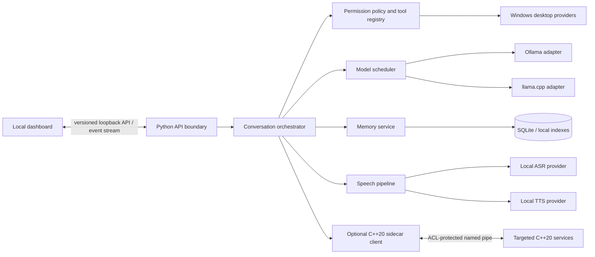

# Jarvis 2.0 Architecture

**Status:** Proposed target architecture. Batch 1 documents the existing system and adds opt-in contracts/configuration scaffolding; it does not replace or activate any runtime component.

## Goals and invariants

- Keep all inference, memory, audio processing, and orchestration on the Windows machine.
- Preserve the current app until each replacement has parity evidence and an explicit opt-in path.
- Treat model output as untrusted input. Only the policy-controlled tool layer may perform desktop actions.
- Discover actual hardware, installed models, and backend health at runtime; do not assume that a model fits just because it is installed.
- Make the 8 GB GPU a scheduled resource. A conservative one-heavy-model-at-a-time policy is the initial default, not a permanent assumption.
- Add C++20 only for measured native/latency-sensitive work. Python remains the orchestration and policy control plane.
- Keep user memory and voice assets out of the source tree and out of Git.

## Existing system (audited baseline)

| Area | Existing implementation | Important boundary |
|---|---|---|
| Startup | `run-jarvis.bat` starts local Ollama, runs the venv Python entry point, and opens the browser | Windows-specific paths and process cleanup are part of today's startup behavior |
| HTTP/UI | `jarvis.py` serves the single-page dashboard and JSON endpoints on `127.0.0.1:8765` | `ThreadingHTTPServer`; no authentication or origin policy |
| Chat | Fixed `qwen3:8b` model through Ollama at `127.0.0.1:11434`; non-streaming response; 4K context and 80-token output cap | One model call, and at most one follow-up call after tool results |
| Speech input | Browser `MediaRecorder` submits audio to the local OpenWhispr bridge; bridge token is read from the user's OpenWhispr config | The microphone, bridge, and model are external to this repository |
| Speech output | Browser `speechSynthesis` or the local Qwen3-TTS Gradio service at `127.0.0.1:8090` | Cloned-voice synthesis returns a completed audio file; GPU handoff stops competing processes |
| Memory | SQLite stores messages, tasks, and notes under `data/` | Chat context is the latest 16 messages; there is no semantic retrieval or schema versioning |
| Tools | Fixed allowlist for app launches, HTTP(S) URL opening, tasks, and notes | No arbitrary shell API, but the current allowlist has no per-action approval flow |
| Telemetry | `nvidia-smi`, Ollama process output, disk usage, and in-process latency values | Telemetry is best-effort; some browser refresh errors are swallowed |

The repository currently has no dependency manifest or lock file. The observed local runtime is Python 3.12.10, `gradio_client` 2.2.0, Ollama 0.40.17, and the locally installed `qwen3:8b` model. These are observations, not a reproducible installation specification.

### Existing runtime dependencies

- **Jarvis Python process:** Python 3.12.10 venv, Python standard library, and `gradio_client` 2.2.0 for the Qwen3-TTS Gradio API.
- **Text inference:** local Ollama 0.40.17 and the locally installed `qwen3:8b` artifact (reported as 5.2 GB by `ollama list`).
- **Cloned speech:** the separate `qwen3-tts` Conda environment; observed packages include `qwen_tts` 0.1.1, PyTorch 2.11.0+cu128, and Transformers 4.57.3. The Qwen3-TTS 12Hz 1.7B Base model is not in this repository.
- **Transcription:** locally installed OpenWhispr and its user-local CLI bridge configuration/token. Neither the token nor its config is stored in this repository.
- **Dashboard:** browser-provided `MediaRecorder`, `getUserMedia`, `AudioContext`, `speechSynthesis`, Canvas, and localStorage APIs; no frontend package manager or framework.
- **GPU telemetry:** NVIDIA driver tooling (`nvidia-smi`) and the Ollama CLI. Missing telemetry tools currently degrade the dashboard data rather than block the app.
- **Desktop integrations:** Windows Calculator/Notepad/Explorer and user-installed ComfyUI, Qwen3-TTS, Applio, and OpenWhispr paths.

These are installed-machine observations. A later packaging batch must turn the required versions and installation checks into an explicit, reviewed manifest without bundling local model weights or user data.

## Target process and module layout

The browser communicates only with the Python API. It does not call model servers or desktop APIs directly. The orchestrator coordinates conversation state and jobs; it does not make resource, permission, or backend decisions by guessing.

## Modules and ownership

1. **API and dashboard adapter**: versioned request/response types, local authentication/CSRF defenses, streaming events, readiness and diagnostics. The current dashboard can be adapted incrementally rather than rewritten.
2. **Orchestrator**: conversation lifecycle, cancellation, bounded tool loop, and correlation IDs. It must not import a concrete model server or execute shell commands.
3. **Capability discovery**: reports CPU, RAM, GPU/VRAM, audio devices, local model catalogs, and backend health with source and freshness metadata. Unavailable probes are reported as unavailable, not as zero-capacity hardware.
4. **Model scheduler**: chooses among installed local models and backends, reserves resources, serializes conflicting loads, applies deadlines, and surfaces fallback decisions. The initial 8 GB profile reserves headroom for the OS/driver and treats large LLM/TTS models as conflicting until measurements prove otherwise.
5. **Backend adapters**: independent Ollama, llama.cpp, and specialized speech adapters implementing the contracts in [MODULE_CONTRACTS.md](MODULE_CONTRACTS.md). They receive local model identifiers or paths; adapters do not download models.
6. **Memory service**: owns versioned SQLite migrations, conversation persistence, task/note APIs, and optional local lexical/vector retrieval. Semantic retrieval is disabled until a local embedding model, privacy behavior, and measured resource budget are selected.
7. **Tool registry and Windows providers**: typed, allowlisted operations with policy checks, previews, scoped approvals, timeouts, and audit events. The registry, not the model, owns authorization.
8. **Speech pipeline**: microphone capture/transcription, voice selection, synthesis, chunk delivery, and playback state. A non-streaming provider may emit one final chunk while the UI still supports incremental providers.
9. **Optional C++20 services**: separate, least-privilege processes for a demonstrated hot path or Windows API/audio task. See [native/PROTOCOL.md](native/PROTOCOL.md). Batch 1 adds no native executable because no profile has established a C++ bottleneck.

## Scheduling and concurrency

- The scheduler discovers free VRAM and model estimates before loading. Estimates include weights, context/KV cache, runtime buffers, and a safety reserve; observed high-water marks refine estimates.
- A request is admitted only if its estimated demand fits the current budget. Otherwise it queues, selects a compatible smaller local model, uses an explicitly enabled CPU fallback, or returns a typed resource error.
- Model load/unload is serialized per GPU. Concurrent requests may share a resident compatible model; the scheduler must not load competing large models just because separate features requested them.
- `max_resident_gpu_models=1` is the conservative example default. It is configurable and may be raised only when capability reports and stress benchmarks demonstrate safe headroom.
- Voice and chat jobs have priorities and deadlines. Preemption is cooperative at request boundaries; no model process is killed by substring matching as a substitute for scheduler state.
- Every fallback is visible in the API and UI. CPU fallback or reduced-quality model selection is never silent.

## Local-only and security boundaries

- Production inference endpoints bind only to loopback. Model references must identify installed Ollama models or local files; the runtime configuration forbids remote inference and automatic downloads.
- The default dashboard remains local. The 2.0 API must add same-origin/CSRF protections and a per-install local authorization token before exposing mutating endpoints.
- Tools use stable IDs and argument schemas. Shell, arbitrary command execution, credential access, and unbounded file operations remain denied. Sensitive operations require an explicit, short-lived, action-scoped approval.
- URL opening is a user-visible tool operation. HTTP is retained only for compatibility/explicit local needs; navigation requires policy approval and rejects malformed or unsupported schemes.
- Logs and diagnostic events redact voice samples, transcripts, memory contents, tokens, and absolute personal paths by default.
- Native services use current-user ACLs on named pipes. They cannot decide policy, access model downloads, or launch arbitrary processes.

## Data and migration

The existing `data/` directory contains SQLite state, voice recordings/prompts, voice settings, and cached audio. It must remain excluded from Git. Batch 2 must introduce an explicit data-root resolver that defaults under `%LOCALAPPDATA%\Jarvis` for new installations while continuing to detect the existing data directory. Migration is copy/backup-first, schema-versioned, restartable, and does not delete the source until the user verifies the migrated database and voice library.

Conversation, task, note, and voice data APIs are separated from storage. SQLite remains the first provider; semantic indexes are rebuildable derived data. Database writes use migrations and transactions, and backups are tested before schema upgrades.

## Rollout

`jarvis.py` and `run-jarvis.bat` remain the default and are not imported or changed by the scaffold. Later batches add a separate v2 startup switch/config entry, run contract and compatibility tests, and compare behavior before any default switch. The default changes only after the acceptance criteria in [DEVELOPMENT_PLAN.md](DEVELOPMENT_PLAN.md) pass. Rollback must return to the existing launcher without data deletion.

## Known baseline limitations

- The app is a small monolith with hard-coded model, endpoints, and resource handoff.
- The model response is non-streaming and the tool loop is bounded to one follow-up.
- The SQLite history window is not semantic memory; there are no migrations or retention policy.
- Local endpoints have no application authentication/origin policy. The prompt and tool allowlist are not a complete authorization boundary.
- GPU competition is handled by process-name/command-line matching; it is not an admission scheduler.
- Unit tests cover three small cases only. Voice, microphone, desktop-process control, dashboard behavior, and real inference lack automated integration coverage.
- Python dependencies are installed in a local virtual environment but not declared in a lock/manifest.
